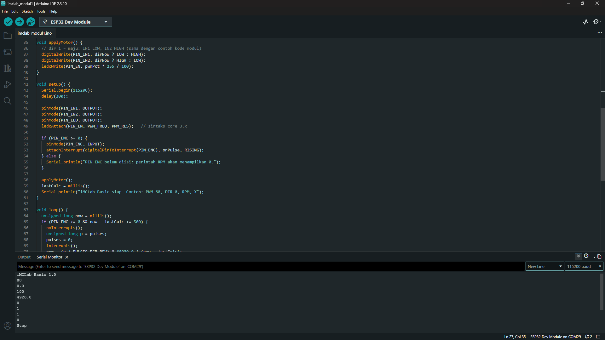

# Laporan Riset UTS: Pemrograman Kit iMCLab

| | |
|---|---|
| **Nama** | `Deva Helal Eka Variski` |
| **NIM** | `23081010313` |
| **Mata Kuliah** | `Robotika` |
| **Dosen** | `Prof. Dr. Basuki Rahmat, S.Si., MT` |


## Ringkasan

Laporan ini merangkum empat eksperimen pada kit **iMCLab** (*Programmable Internet-Based Motor Control Lab*) yang berbasis ESP32 dan driver motor DC:

1. Pemrograman basic robotika dengan kit iMCLab
2. Pemrograman robotika dengan kit iMCLab menggunakan Python
3. Pemrograman iMCLab berbasis Blynk
4. Pemrograman OTA berbasis Blynk

Seluruh eksperimen berhasil dijalankan. Catatan penting: kecepatan putar (RPM) tidak dapat diukur karena baling-baling pada kit yang digunakan patah, sehingga sensor putaran tidak mendeteksi putaran (lihat bagian *Kendala dan Solusi*).

## Alat dan Bahan

- Kit iMCLab (ESP32 DevKit, driver motor, motor DC, LED, sensor putaran)
- Adaptor DC (jack DC1) dan kabel micro USB (data)
- Laptop dengan Arduino IDE 2.x (Arduino-ESP32 core 3.3.12), Python 3.x
- Library Arduino: **Blynk** (Blynk v1.4.0), ArduinoOTA (bawaan core ESP32)
- Library Python: `pyserial`, `matplotlib`
- Akun Blynk (blynk.cloud) dan jaringan WiFi 2.4 GHz

## Konfigurasi Pin

| Fungsi | Pin ESP32 |
|---|---|
| Enable / PWM kecepatan motor | GPIO 12 |
| Arah motor (IN1) | GPIO 27 |
| Arah motor (IN2) | GPIO 26 |
| LED biru onboard | GPIO 2 |
| Sensor putaran | GPIO 13 |

Pin motor sesuai dengan kode referensi dosen (IN1 = 27, IN2 = 26, Enable = 12). Pin sensor putaran ditemukan lewat sketch pemindai pin.

## Struktur Repositori

```
.
├── README.md                 # laporan ini
├── modul1/imclab_modul1.ino
├── modul2/imclab_modul2.py
├── modul3/imclab_modul3_blynk.ino
├── modul4/imclab_modul4_final.ino
├── tools/                    # sketch bantu: motor_test, pin_scanner, pin_auto
└── images/                   # screenshot dan foto
```

---

## Modul 1: Pemrograman Basic iMCLab

### Tujuan
Mengendalikan kecepatan (PWM) dan arah motor DC serta LED pada iMCLab melalui perintah serial.

### Dasar Teori
- **PWM (Pulse Width Modulation):** kecepatan motor diatur dengan mengubah duty cycle sinyal pada pin enable; makin besar duty cycle, makin besar tegangan rata-rata pada motor.
- **Driver motor (H-bridge):** arah putar ditentukan oleh kombinasi logika pada IN1 dan IN2.
- **Komunikasi serial:** ESP32 menerima perintah teks lewat USB (115200 baud).

### Langkah Kerja
1. Pasang board, pilih **ESP32 Dev Module** dan port yang sesuai, atur **Upload Speed 115200**.
2. Upload `imclab_modul1.ino`.
3. Buka Serial Monitor (115200 baud, line ending *Newline*) dan kirim perintah:

| Perintah | Fungsi |
|---|---|
| `VER` | menampilkan versi firmware |
| `PWM 80` | kecepatan 0 sampai 100 persen |
| `DIR 1` / `DIR 0` | arah maju / mundur |
| `LED 1` / `LED 0` | LED biru nyala / mati |
| `RPM` | membaca RPM (membutuhkan sensor yang berfungsi) |
| `X` | menghentikan motor |

### Hasil


*Gambar 1. Tampilan Serial Monitor pada pengujian perintah.*


*Gambar 2. Kit iMCLab yang digunakan.*

### Analisis
- Motor tidak bergerak pada PWM 60 dan 70, dan mulai berputar pada PWM sekitar **80 persen**. Ini disebut **zona mati (dead zone)**: pada PWM rendah, tegangan rata-rata belum cukup untuk mengatasi gesekan statis poros dan rugi tegangan pada driver.
- Nilai ini konsisten dengan kode referensi yang memulai kenaikan kecepatan dari duty cycle 200 dari 255 (sekitar 78 persen).
- Perintah `DIR` membalik arah putar dengan menukar logika IN1 dan IN2, dan perintah `X` menurunkan PWM menjadi 0 sehingga motor berhenti.

### Kesimpulan
Kecepatan dan arah motor dapat dikendalikan lewat PWM dan logika IN1/IN2; motor memiliki zona mati sehingga baru bergerak mulai sekitar PWM 80 persen.

---

## Modul 2: Pemrograman iMCLab Menggunakan Python

### Tujuan
Mengendalikan iMCLab dari Python lewat komunikasi serial, menjalankan uji step PWM, serta mencatat dan menampilkan data.

### Dasar Teori
- Library **pySerial** mengirim dan menerima teks lewat port serial.
- Uji **step**: PWM diubah bertahap dan respons motor diamati terhadap waktu.
- Data disimpan ke **CSV** dan divisualisasikan dengan **matplotlib**.

### Langkah Kerja
1. Upload `imclab_modul1.ino` ke board, lalu **tutup Serial Monitor**.
2. Install library: `pip install pyserial matplotlib`.
3. Sesuaikan `PORT` di script, lalu jalankan: `python imclab_modul2.py`.
4. Script menjalankan profil uji: PWM 60, 70, 80, 90, 100 (maju), berhenti, lalu 80 dan 100 (mundur).
5. Hasil tersimpan di `data_imclab.csv` dan `grafik_imclab.png`.

### Hasil


*Gambar 3. Grafik respons motor terhadap step PWM.*


*Gambar 4. Keluaran terminal saat script berjalan.*

Cuplikan data (`Modul/data_imclab.csv`):

```
[tempel beberapa baris CSV di sini]
```

### Analisis
- `[isi: pada PWM berapa motor mulai bergerak menurut data, dan apa yang terlihat pada PWM 60 dan 70]`
- Kecepatan putar tidak dapat dianalisis secara kuantitatif karena sensor putaran tidak mendeteksi putaran (baling-baling patah). Analisis dilakukan secara kualitatif terhadap perilaku motor pada tiap tingkat PWM dan arah.
- Kontrol lewat Python memungkinkan pengujian yang otomatis, berulang, dan terdokumentasi (data tercatat dan dapat dianalisis ulang), dibandingkan perintah manual lewat Serial Monitor.

### Kesimpulan
Python dapat mengendalikan iMCLab dan mencatat data eksperimen secara otomatis; hasil uji step menunjukkan adanya zona mati pada PWM rendah.

---

## Modul 3: Pemrograman iMCLab Berbasis Blynk

### Tujuan
Memantau dan mengendalikan motor iMCLab dari dashboard Blynk melalui internet.

### Dasar Teori
- **Blynk IoT:** platform cloud untuk mengendalikan perangkat lewat *virtual pin* dan widget dashboard.
- Alur data: dashboard, cloud Blynk, WiFi, ESP32.
- Setiap widget terhubung ke *datastream* (virtual pin) yang dibaca atau ditulis oleh firmware.

### Langkah Kerja
1. Install library **Blynk** (v1.3.5 atau lebih baru, kompatibel dengan ESP32 core 3.x).
2. Buat Template **iMCLab** (ESP32, WiFi) dengan datastream:

| Pin | Fungsi | Tipe |
|---|---|---|
| V0 | RPM | Double (0-5000) |
| V1 | PWM | Integer (0-100) |
| V2 | Arah | Integer (0-1) |
| V3 | LED | Integer (0-1) |

3. Buat Web Dashboard: Gauge dan Chart (V0), Slider (V1), Switch (V2 dan V3).
4. Buat Device dari template, salin `BLYNK_TEMPLATE_ID`, `BLYNK_TEMPLATE_NAME`, dan `BLYNK_AUTH_TOKEN` ke sketch, isi `ssid` dan `pass` (WiFi 2.4 GHz).
5. Upload `imclab_modul3_blynk.ino` dan pastikan Serial Monitor menampilkan Blynk `Ready` dan device berstatus **Online**.

### Hasil


*Gambar 5. Template dan datastream di Blynk.*


*Gambar 6. Dashboard dengan status Online (gauge, slider, switch).*


*Gambar 7. Serial Monitor: WiFi tersambung dan Blynk siap.*

### Analisis
- Slider PWM, switch arah, dan switch LED pada dashboard berhasil mengendalikan motor dan LED secara jarak jauh.
- Terdapat jeda antara perubahan di dashboard dan reaksi motor; ping ke server Blynk tercatat sekitar 527 ms (`[isi: jeda yang kamu amati]`). Kontrol lewat internet lebih fleksibel (dapat dilakukan dari mana saja) tetapi memiliki latensi dan bergantung pada kualitas jaringan, berbeda dengan kontrol kabel pada Modul 1 dan 2 yang langsung.
- Slider di bawah sekitar 80 persen tidak menggerakkan motor karena zona mati.
- Gauge RPM tidak menampilkan kecepatan putar yang bermakna karena sensor putaran tidak mendeteksi putaran (baling-baling patah). Pengujian tampilan gauge dan chart dengan nilai tetap menunjukkan bahwa datastream V0 dan widget bekerja dengan benar.

### Kesimpulan
Dashboard Blynk berhasil memantau dan mengendalikan iMCLab melalui WiFi dan internet, dengan latensi yang perlu diperhitungkan.

---

## Modul 4: Pemrograman OTA Berbasis Blynk

### Tujuan
Memperbarui firmware ESP32 tanpa kabel (*Over-The-Air*) pada sistem iMCLab yang terhubung ke Blynk.

### Dasar Teori
- **OTA:** firmware baru dikirim lewat jaringan, sehingga tidak membutuhkan akses fisik ke board.
- Firmware diberi nomor versi (`BLYNK_FIRMWARE_VERSION`) agar pembaruan dapat dibedakan.
- Pada eksperimen ini OTA dilakukan lewat **ArduinoOTA** (WiFi lokal) pada sketch yang tetap terhubung ke Blynk; jalur resmi Blynk.Air (OTA lewat Blynk Console) memerlukan kerangka Blynk.Edgent dan tidak digunakan.

### Langkah Kerja
1. Tambahkan datastream **V5** (String) dan widget **Label** untuk menampilkan versi firmware.
2. Upload `imclab_modul4_final.ino` lewat kabel dengan versi **1.0.0** dan `PWM_MAX = 100`. Dashboard menampilkan label V5 = 1.0.0.
3. Ubah dua baris di sketch:
   ```cpp
   #define BLYNK_FIRMWARE_VERSION "1.0.1"
   const int PWM_MAX = 90;
   ```
4. Pastikan laptop dan ESP32 berada di WiFi yang sama. Pilih port jaringan **imclab** di **Tools > Port**, lalu Upload.
5. Setelah selesai, board restart sendiri dan tersambung ke Blynk lagi.

### Hasil


*Gambar 8. Sebelum update: V5 = 1.0.0, slider dapat mencapai 100.*


*Gambar 9. Log upload lewat jaringan (`Sending invitation to 10.182.6.9` sampai `100% Done`).*


*Gambar 10. Sesudah update: V5 = 1.0.1, slider tertahan di 90.*

### Analisis
- Transfer firmware lewat WiFi berjalan sampai 100 persen tanpa kabel USB; log menampilkan peringatan `Unexpected response from device` pada akhir proses yang tidak menghalangi board memakai firmware baru.
- Perubahan terlihat pada dua hal: label V5 berubah dari 1.0.0 menjadi 1.0.1, dan batas PWM menjadi 90 (slider yang digeser ke 100 kembali ke 90).
- Keuntungan OTA dibanding upload kabel: tidak perlu akses fisik, mudah untuk perangkat yang sulit dijangkau, dan proses pembaruan dapat dilakukan berulang. Hal yang perlu dijaga: laptop dan board harus satu jaringan, versi harus dinaikkan agar perubahan dapat dilacak, dan motor dihentikan saat proses update (`ArduinoOTA.onStart`).

### Kesimpulan
Firmware iMCLab berhasil diperbarui dari versi 1.0.0 ke 1.0.1 tanpa kabel, dan perubahan terverifikasi dari dashboard Blynk.

---

## Kendala dan Solusi

| Kendala | Penyebab | Solusi |
|---|---|---|
| Port serial tidak muncul | Driver USB-serial dan kabel | Driver CP210x terpasang dan kabel data digunakan |
| Upload gagal setelah `Changing baud rate to 921600` | Kecepatan upload terlalu tinggi | Upload Speed diturunkan ke 115200 |
| `Failed to connect to ESP32: No serial data received` | Board tidak masuk mode upload | Tombol BOOT ditahan saat upload dan adaptor DC dicabut |
| Library "Blynk" tidak ditemukan | Pemilihan paket di Library Manager | Memasang library **Blynk** (v1.3.5 atau lebih baru) |
| Terhenti pada `Connecting to WiFi` | Jaringan tidak sesuai | Menggunakan WiFi 2.4 GHz dan memeriksa SSID dan password |
| Motor tidak bergerak pada PWM rendah | Zona mati | Menggunakan PWM 80 persen atau lebih |
| RPM selalu 0 | Baling-baling pada kit patah sehingga sensor putaran tidak mendeteksi putaran | Logika sensor tetap diimplementasikan; pengukuran RPM menunggu perbaikan baling-baling |

## Kesimpulan Umum

Keempat eksperimen menunjukkan alur kerja dari kontrol lokal (serial), otomatisasi dengan Python, kontrol jarak jauh lewat Blynk, hingga pembaruan firmware tanpa kabel (OTA). Kendali kecepatan dan arah motor berjalan dengan baik; pengukuran kecepatan putar tidak dapat dilakukan karena keterbatasan hardware (baling-baling patah).

## Cara Menjalankan Ulang

1. Clone repositori ini.
2. Buka sketch yang diinginkan di Arduino IDE (Board **ESP32 Dev Module**, Upload Speed **115200**).
3. Untuk Modul 3 dan 4, isi `BLYNK_TEMPLATE_ID`, `BLYNK_AUTH_TOKEN`, `ssid`, dan `pass` dengan data milik sendiri.
4. Untuk Modul 2, jalankan `pip install pyserial matplotlib`, atur `PORT` di script, lalu `python imclab_modul2.py`.

> **Keamanan:** jangan mengunggah `BLYNK_AUTH_TOKEN`, password WiFi, atau data pribadi ke GitHub. Gunakan placeholder seperti `ISI_AUTH_TOKEN` pada file yang di-commit.

## Referensi

- Blynk Documentation: OTA firmware updates (Blynk.Air): https://docs.blynk.io/en/blynk.edgent/updating-devices-firmwares-ota
- Blynk Library: https://github.com/Blynk-Technologies/blynk-library
- Arduino-ESP32 (Espressif): https://github.com/espressif/arduino-esp32
- Kode referensi kontrol motor dari dosen (pin IN1 = 27, IN2 = 26, Enable = 12)
